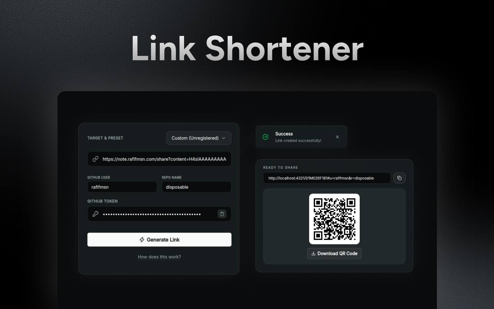

# Link Shortener - rafifmsn/tool



A high-performance, serverless, and completely free link shortener built using Astro, Tailwind CSS, and GitHub repo as the database. This project is designed for users who want 100% control over their data with zero hosting costs.

## How It Works

This project leverages a "Client-to-CDN" pattern:

1. **Creation:** The admin dashboard uses your GitHub Personal Access Token (PAT) to commit a JSON file directly to your chosen repository via the GitHub API.
2. **Storage:** Links are stored as JSON files in a time-structured directory: `data/YYYY/MM/ULID.json`.
3. **Resolution:** The `404.astro` page acts as a "Smart Resolver." It detects the storage location, fetches the raw data from GitHub's CDN, and performs the redirect.

## Resolver Flow

When someone clicks a link, the `404.astro` script executes this logic in order:

1. **Priority 1 (The Hash):** Does the URL have `#u=` and `&r=`? If yes, it fetches from that user/repo immediately. This is the "portable" version that works for any GitHub repo without registration.
2. **Priority 2 (The Prefix):** Is there a "folder" before the ID (like `/r/` or `/dl/`)? If yes, it checks `domains.json` for a matching prefix to find the repo.
3. **Priority 3 (The Default):** Is it just `domain.com/ID`? If yes, it checks `domains.json` for the entry marked `"default": true`.
4. **Fallback:** If all the above fail (or the file doesn't exist on GitHub), the system waits 5 seconds and redirects the user to the home page.

## Privacy, Encryption & Security Scope

This project is built on a "Local-First" architecture. Because there is no external database or specialized authentication server, understanding your security boundaries is vital to keeping your environment safe.

### GitHub Token Protection

Your GitHub Personal Access Token (PAT) is the key to your "database." To avoid storing it in plaintext or relying on a hardcoded key in the bundle, we encrypt it using the browser's **Web Crypto API (`AES-GCM` 256-bit)** with a **non-extractable `CryptoKey`**:

- **Non-Extractable Key:** The browser generates a per-origin `AES-GCM` key with `extractable: false` and stores the `CryptoKey` handle in IndexedDB. JavaScript can use the key to encrypt and decrypt, but cannot export the raw key bytes.
- **Randomized IV:** Each save generates a fresh 12-byte initialization vector (`crypto.getRandomValues`), storing `{ iv, ciphertext }` in IndexedDB.

**Logic Flow:**

- **Storage:** `Token` + `Non-Extractable CryptoKey` + `Random IV` -> `AES-GCM Encrypt` -> `IndexedDB`.
- **Retrieval:** `IndexedDB` (`{ iv, ciphertext }` + `CryptoKey`) -> `AES-GCM Decrypt` -> `Original Token`.
- **Clearing Saved Token:** To remove a previously saved token from the browser, use the trash icon next to the Token field in the dashboard: this deletes both the encrypted payload and the `CryptoKey` from IndexedDB.

### Security Boundaries

While both the creation dashboard and the resolver engine apply sanitization rules to block persistent Cross-Site Scripting (XSS) and path-traversal inputs, you must understand what this client-side crypto approach actually defends against:

| Threat Vector                                        | Security Layer / Status                       | What It Actually Means                                                                                                                                                                                                                                   |
| ---------------------------------------------------- | --------------------------------------------- | -------------------------------------------------------------------------------------------------------------------------------------------------------------------------------------------------------------------------------------------------------- |
| **External Websites Trying to Steal Data**           | **Protected** (via Browser SOP)               | The browser's Same-Origin Policy (SOP) completely locks down your IndexedDB store. `evil.com` cannot view or query your application's data.                                                                                                               |
| **Offline IndexedDB Dump / Bundle Inspection**       | **Protected** (via Web Crypto Non-Extractable) | No static encryption key exists in the source bundle, and the `CryptoKey` stored in IndexedDB cannot be exported as raw bytes via JavaScript.                                                                                                             |
| **Active Cross-Site Scripting (XSS) Data Theft**     | **Mitigated** (via CSP)                       | If an attacker gains script execution inside your origin, they can still invoke `crypto.subtle.decrypt()` using the IndexedDB key handle or read the token from memory. However, strict CSP `connect-src` rules block exfiltrating it to external servers. |
| **Physical Theft of Device / Unlocked Workstations** | **Not Protected** (OS Dependent)              | If an unauthorized individual accesses your physical machine, they can use browser inspection interfaces to interact with local memory variables or the active origin.                                                                                     |

**Security Tips:**
- Web Crypto (`crypto.subtle`) requires a secure context (`https://` or `http://localhost`), so self-hosted deployments must terminate TLS (for example via Caddy or Cloudflare Tunnel).
- Cloudflare Pages reads `public/_headers`, and the Docker image applies the same headers in `nginx.conf`; other static hosts may need manual header rules.
- Use a Fine-Grained Personal Access Token limited to `Contents` read/write on your links repository only.
- Put the dashboard behind Cloudflare Zero Trust or an identity proxy if you need access control, since all token logic runs client-side.

## Data Structure

Links are organized to prevent GitHub directory throttling and ensure fast API lookups:

```text
repository-root/
└── data/
    └── 2026/
        └── 02/
            └── 01KGK9DBCY.json

```

**JSON Schema:**

```json
{
  "target": "https://rafifmsn.com/absolute-path",
  "repoUser": "rafifmsn",
  "repoName": "link",
  "created": "2026-02-05T08:00:00Z"
}
```

## Setup & Configuration

### Environment Variables & Custom Configuration

You can customize the app URL using environment variables:

- `PUBLIC_APP_URL`: Configure the canonical app URL (defaults to `"https://s.rafifmsn.com"`).

#### Configuring Locally
Create a `.env` file in the root directory:
```ini
PUBLIC_APP_URL="https://links.mybrand.com"
PORT=8080
```

#### Configuring in Docker Compose
You can pass this variable as build arguments when building the image:
```bash
docker compose build --build-arg PUBLIC_APP_URL="https://links.mybrand.com"
```
Or define it in your shell environment before running:
```bash
PUBLIC_APP_URL="https://links.mybrand.com" docker compose build
```

### 1. Repository Setup

- Create a public GitHub repository to hold your link data.
- Configure `public/domains.json` in your Astro project:
  ```json
  [
    {
      "prefix": "",
      "name": "Default",
      "user": "your-username",
      "repo": "your-link-repo",
      "default": true
    },
    {
      "prefix": "dl",
      "name": "Downloads",
      "user": "your-username",
      "repo": "another-repo"
    }
  ]
  ```

### 2. Deployment

#### Static Hosting (Cloudflare Pages, Vercel, Netlify, etc.)

- Connect your repository to your hosting provider.
- Build Settings:
  - Framework: `Astro`
  - Build Command: `npm run build`
  - Output Directory: `dist`

#### Docker Deployment

You can self-host this static build or deploy it using Docker. A multi-stage `Dockerfile` and `docker-compose.yml` are provided.

##### Using Docker Compose
Start the service with:
```bash
docker compose up -d
```
By default, the dashboard and resolver will be served on port `8080` (i.e. `http://localhost:8080`). To override the port, set the `PORT` environment variable:
```bash
PORT=9000 docker compose up -d
```

##### Build and Run Manually
```bash
docker build -t link .
docker run -p 8080:80 link
```

### 3. Usage

- Open your deployed dashboard.
- Enter your PAT and Destination URL.
- The "Smart Match" logic automatically detects if you are using a registered repo and generates a clean URL. Otherwise, it generates a portable Hash-based URL.
